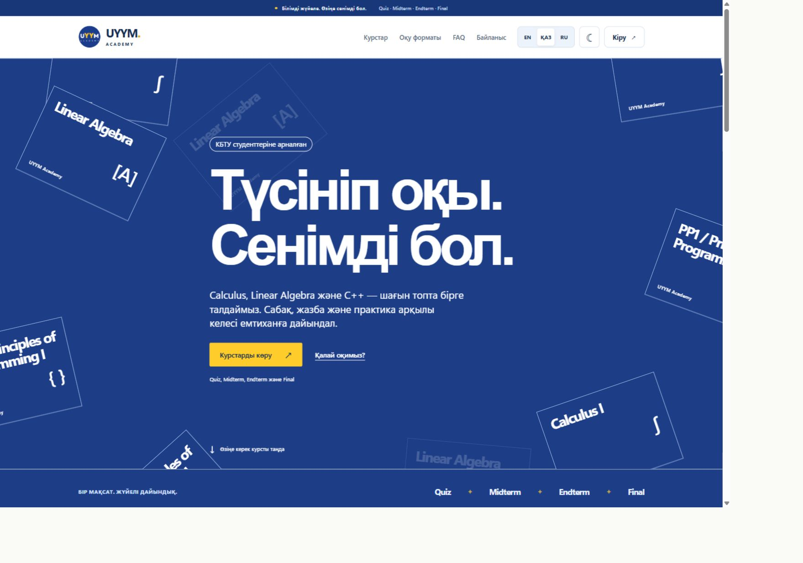
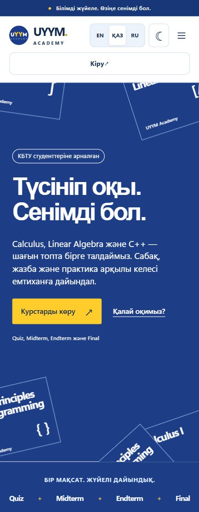
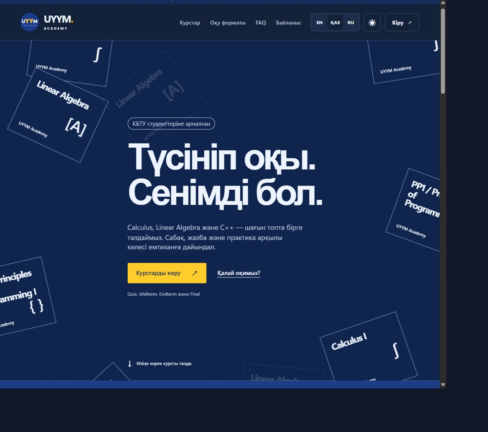

# Первый экран с коллажем курсов

Локальная ветка `codex/home-course-collage`, база — `origin/main` / `2985bba`. Production, настройки провайдеров, авторизация, учебные кабинеты и плеер не изменены. Публикация этого экрана требует отдельного согласования.

## Направление

Референс: [247artists](https://247artists.com/), раздел Education, [Curated 1310](https://curated.design/sections/1310/). Curated MCP не подключён; полный предоставленный capture изучен локально. Референсное изображение, чужие названия, логотипы и код в продукт не включены.

Сохранены полноэкранная цветная поверхность, крупная двухстрочная типографика, смещённый вправо текстовый блок и плоские повёрнутые карточки по краям. Новая композиция заменяет прежний split hero; каталог, цены и форма заявки остаются прежними.

```text
Desktop                           Mobile
┌ cover ─────────────── cover ┐    ┌ cover ───── cover ┐
│       label                │    │ label             │
│       Large heading        │    │ Large heading     │
│       Second line          │    │ Second line       │
│       description + actions│    │ description       │
└ cover ───────── cover ──────┘    │ actions           │
                                 └ cover ───── cover ┘
```

По уточнению владельца сохранена композиция референса, а палитра возвращена к UYYM: основной синий `#1d3e87`, белый текст `#ffffff`, светлые контуры `#9bb2e1`, жёлтая кнопка и focus `#ffcd2b`, тёмно-синий текст кнопки `#142c50`. Dark: глубокий синий `#10254e`, текст `#eef4ff`. Шрифт заголовка — локальный Arial с Segoe UI fallback, основной — существующий системный стек. EN/русский/казахские буквы проверены в браузере. Внешних шрифтов и новых зависимостей нет.

Коллаж получает названия из существующего публичного списка курсов. Повторные обложки декоративны, скрыты от accessibility tree и не являются дополнительными курсами или неработающими кнопками. Полный доступный каталог с действующей записью находится ниже. Авторские названия и описания из API не переводятся и экранируются React.

В доступном статичном capture нет отдельных motion notes. Добавлено одно CSS-появление обложек до 920 ms с учётом задержек и отклик основной ссылки на hover. Постоянного движения, scroll handlers и animation-библиотеки нет; `prefers-reduced-motion` отключает эффекты.

## Проверено

- TypeScript и production build — PASS; полный набор: **100 PASS, 1 SKIP, 0 FAIL**. Пропущен прежний тест отдельной PostgreSQL test database.
- Собранный frontend на изолированном локальном BFF/PGlite: 360/390/768/1440 px × EN/ҚАЗ/RU × light/dark, **24 состояния**. Нет горизонтального переполнения, обе строки заголовка помещаются. Текст и действия в hero соответствуют контрасту **4,5:1** или выше.
- Видимый клавиатурный focus 3 px; Enter по основной ссылке открывает каталог; PP1 открывает прежнюю форму; Escape возвращает focus на кнопку курса. Заявки не отправлялись.
- Новые тесты проверяют языки/навигацию, семантику, экранирование авторского текста, пустой каталог и контраст обеих тем. Существующая проверка отложенной загрузки кабинетов проходит.
- Проверка относится к responsive Chromium и локальным тестовым данным. Физические мобильные устройства, системное переключение reduced motion и production-сессии не проверялись. CSS для reduced motion проверен по исходнику.

## Превью

[http://localhost:18878/](http://localhost:18878/) — локальный процесс с изолированными тестовыми данными, без настоящих Supabase/Drive credentials. Оставлен первый экран на қазақша / light. Первый визит без сохранённого языка по-прежнему EN.

При необходимости перезапустить после сборки:

```powershell
npm.cmd run build
$env:NODE_ENV='test'
$env:UYYM_UI_ORIGIN='http://localhost:18878'
npx.cmd tsx tests/ui-fixture.ts
```




