# Кабинеты UYYM — локальное ревью, 16 октября 2026

Ветка `codex/workspace-redesign` основана на проверенном `origin/main` (`c19b198`). Новый дизайн не опубликован. Пользовательские изменения и корневой `init.mp4` исключены из коммита.

## Что существовало и что изменилось

EN по умолчанию, EN/KK/RU, сохранение темы/языка, фильтрация прежнего FAQ и отложенная загрузка кабинетов уже работали. Они сохранены. Добавлены переводы новых экранов и корректные казахские названия месяцев вместо `M10`; часовой пояс показан в кабинете.

Общая оболочка заменяет публичную шапку внутри кабинета. На desktop доступны sidebar, сгруппированные разделы, профиль и выход; на телефоне — доступное меню с переходом на главную. Формы, таблицы, карточки, состояния, focus и обе темы объединены общими токенами. Новых зависимостей нет.

| Роль | Сохранённые действия и новое представление |
|---|---|
| STUDENT | Главная с продолжением урока, курсами, явным прогрессом, заданиями, расписанием и объявлениями. Курсовые уроки, архив, файлы, версии ответов и личные оценки остаются доступны. Возврат после сдачи обновляет сводку. |
| TEACHER | Свои группы и разрешённое управление доступом; учебный контент, уроки, задания, проверка, посещаемость, архив и объявления. Назначение на весь курс имеет нейтральный статус Course-level. |
| ADMIN | Заявки, пользователи, курсы, группы, преподаватели, доступы, оплаты, контент, браузеры, настройки и журнал. Сессии/операции с аккаунтом остаются в существующих деталях пользователя. Заявки показаны таблицей / мобильными карточками; поиск, статусы и подтверждение личности сохранены. |
| Урок | Программа рядом с видео на desktop; раскрываемая программа перед видео на телефоне. Действующие задания/материалы и переходы между реальными уроками. Плеер пересоздаётся только при смене урока. |

Названия и описания курсов/уроков, задания, сообщения, расписания, FAQ и отзывы преподавателя из БД не переводятся автоматически. Их языковые версии владелец готовит отдельно. Схема API пока не содержит недель/модулей программы, отдельных таймкодов, отображаемого имени преподавателя урока и специальной ссылки подключения к эфиру. Поэтому эти функции не имитируются новыми кнопками.

## Источники и решение по установке

Инструкции прочитаны и применены напрямую. Skills/плагины, CLI, hooks, launcher и скачанные скрипты не устанавливались и не запускались. Код компонентов написан для существующего React/Vite; сторонний шаблон не скопирован.

| Официальный источник | Лицензия / применение |
|---|---|
| [Impeccable](https://github.com/pbakaus/impeccable), [SKILL](https://github.com/pbakaus/impeccable/blob/main/.agents/skills/impeccable/SKILL.md) | Apache-2.0. Основной подход: shape, critique, layout, typeset, harden, adapt, polish. Прочитаны playbooks и craft-floor. Использованы ручная проверка и два независимых ревью; внешний detector не запускался. |
| [UI UX Pro Max](https://github.com/nextlevelbuilder/ui-ux-pro-max-skill) | MIT. Прочитаны README/SKILL и открытые рекомендации education/dashboard: приоритет доступности, плотности, понятных состояний и touch. Premium не использован. |
| [shadcn/ui](https://github.com/shadcn-ui/ui), [skills](https://ui.shadcn.com/docs/skills), [Vite](https://ui.shadcn.com/docs/installation/vite), [dashboard blocks](https://ui.shadcn.com/blocks?category=dashboard) | MIT. Взяты паттерны композиции sidebar/table/dialog и семантических цветов. CLI добавил бы конфигурацию/компоненты и зависимости; существующие native controls и Dialog подходят проекту без установки. |
| [shadcn-admin](https://github.com/satnaing/shadcn-admin) | MIT. Только структура навигации и плотность управления; его router, demo и auth не перенесены. |
| [Vercel agent-skills](https://github.com/vercel-labs/agent-skills) | MIT в прочитанных инструкциях. web-design-guidelines и react-best-practices: labels/focus, loading/error, responsive, lazy chunks и независимые запросы. Next.js/RSC-приёмы не применялись. |

Публичные LMS-референсы: [Thinkific Learner Hub](https://support.thinkific.com/hc/en-us/articles/37873047985047-The-Learner-Hub) — доступные ученику разделы и продолжение; [Teachable](https://support.teachable.com/en/articles/11691026-student-dashboard) — ясная библиотека курсов; [LearnWorlds](https://support.learnworlds.com/support/solutions/articles/12000053451-how-to-customize-your-course-player-and-course-navigation) — программа и плеер; [Circle](https://help.circle.so/p/courses/course-management/using-the-course-dashboard) — обзор курса. Их коммерческие функции не добавлялись в UYYM.

## Проверки

Все браузерные проверки выполнены локально на настоящем BFF и SQL PGlite с симулированным Auth. Это не проверка реального Supabase/Drive. Тестовые записи явно помечены `LOCAL FIXTURE` / `LOCAL UI FIXTURE`.

- TypeScript и production build: PASS. Полный набор: **97 PASS, 1 SKIP, 0 FAIL**. Пропущенный тест требует отдельной PostgreSQL test database.
- Основные экраны: STUDENT home/урок, TEACHER группы, ADMIN заявки; EN/KK/RU × light/dark × около 390/768/1440 CSS px. Горизонтальное переполнение и вычисленный контраст проверены; обнаруженные проблемы исправлены и перепроверены.
- Все 11 разделов ADMIN: desktop/phone, обе темы. TEACHER: группы, ученики, разрешённая форма доступа, все четыре раздела контента, проверка и форма оценки.
- STUDENT: новая версия ответа сохранилась; преподаватель увидел v1/v2, выставил 18/20 и комментарий; ученик увидел свой результат. После сдачи работа исчезает из ожидающих в сводке.
- Заявки: поиск, фильтр, пустой результат, детали и обязательная проверка личности перед одобрением. Реальные заявки не отправлялись.
- Ошибка сохранения дублирующего курса оставляет введённые значения; подтверждённый отказ не создаёт курс. Ошибка lazy shell показывает безопасную кнопку перезагрузки; после перезагрузки кабинет работает. Однократная 503 списка курсов оставляет доступный Retry/Refresh.
- Проверены Escape, цикл Tab/Shift+Tab, возврат фокуса и мобильная программа с клавиатуры. Язык/тема сохраняются после refresh. Reduced motion проверен по CSS; системное переключение режима ОС не эмулировалось.
- Регрессионные тесты: сводка из реальных состояний, экранирование авторского текста, даты UTC→Almaty/KK, role-specific completion, идентичность плеера при языке/смене урока и нейтральный статус назначения курса. Существующие проверки device/session/enrollment/grant/IDOR продолжают проходить.

Ручное независимое ревью выявило и помогло исправить перенос completion между уроками, устаревание сводки, отсутствие mobile home, необработанную ошибку загрузки оболочки и неверный статус course-level. Серверные роли и разрешения не менялись; backend, миграции, .env и настройки провайдеров не затронуты.

### Размер загрузки

| Начальный JS | До (`c19b198`) | После |
|---|---:|---:|
| Без сжатия | 323 012 B | 326 163 B |
| gzip | 100 768 B | 101 550 B |

Рост около 1% / 0,8% gzip. Ролевые панели и плеер остаются отложенными. Дополнительные стили кабинета (~33 kB, ~6,1 kB gzip) загружаются с оболочкой; основной CSS ~97,6 kB. Это измерение размера, не доказательство ускорения плеера.

### BLOCKED / отдельная приёмка

Реальные PP1 STUDENT, Drive/video streaming, первый кадр, перемотка/отзыв grant во время реального просмотра, скачивание реального защищённого файла, Safari/iPhone/Android и системный reduced motion не проверены этой локальной средой. Нужны одобренные браузеры и настоящие разрешённые материалы. Production не изменялся. Полноценные переводы авторских материалов требуют отдельных данных владельца.

## Как открыть

Доступное превью: [localhost:18878/#account](http://localhost:18878/#account). Оно показывает собранный frontend и изолированный тестовый backend, без реальных сервисных ключей. Открытая вкладка оставлена как STUDENT.

После остановки процесса из корня репозитория:

```powershell
npm.cmd run build
$env:NODE_ENV='test'
$env:UYYM_UI_ORIGIN='http://localhost:18878'
npx.cmd tsx tests/ui-fixture.ts
```

У тестовых ролей отдельные фиктивные учётные записи, описанные в `tests/ui-fixture.ts`; не используйте в этой среде реальный пароль. Данные существуют только в памяти и сбрасываются при перезапуске. Для повторения отказов доступны только локальные flags `UYYM_UI_FAIL_CHUNK=chrome` и `UYYM_UI_FAIL_COURSES_READ=2`. Before-снимки получены из отдельно собранного `c19b198`, без смены рабочих файлов; опциональный `UYYM_UI_BASELINE=1` требует этой локальной сборки в `work/redesign/baseline-build`.

## Скриншоты

Снимки ниже используют только локальные фиктивные данные. До и после сняты в одном браузере. Desktop-кадры — viewport, без артефактов full-page захвата закреплённой шапки. Они не доказывают работоспособность Drive.

| Экран | До | После |
|---|---|---|
| ADMIN заявки | 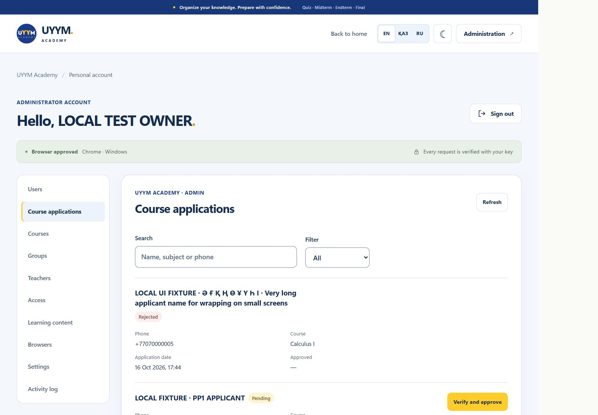 | 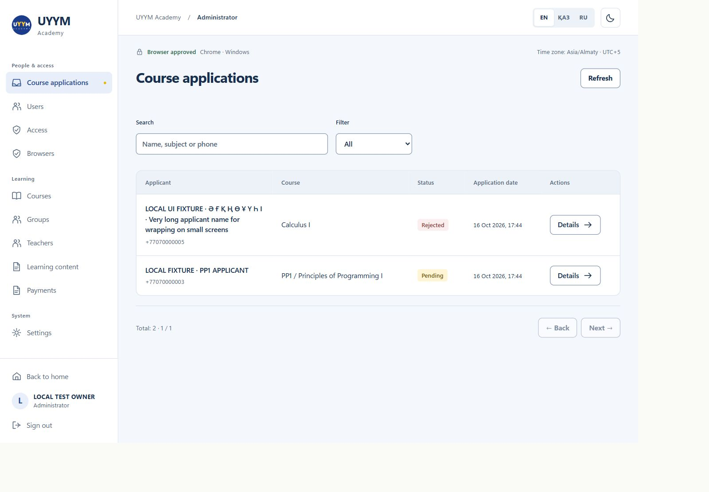 |
| STUDENT главная | 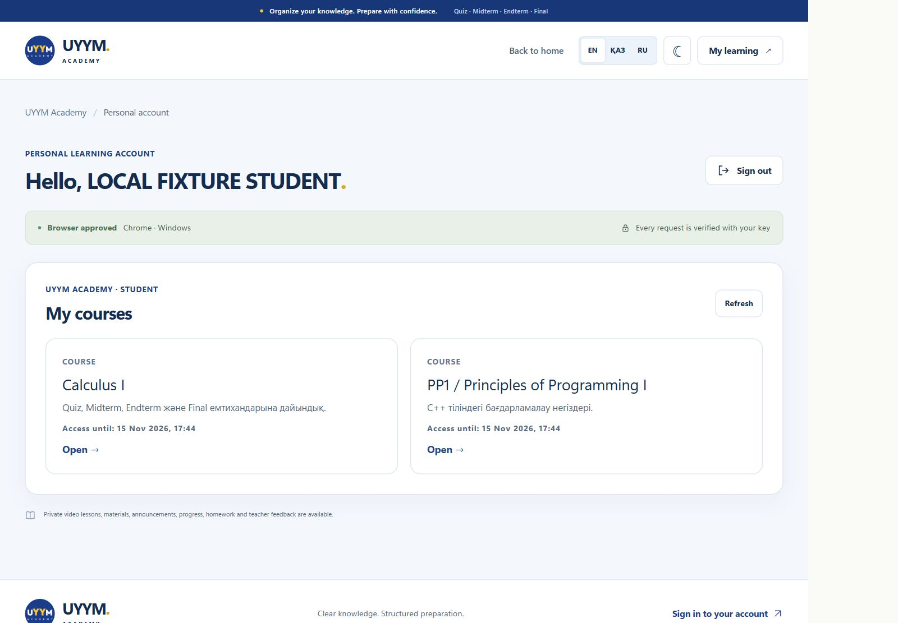 | 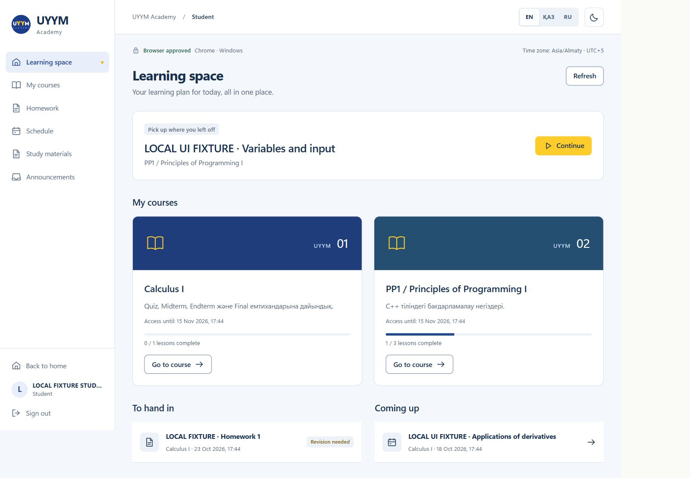 |
| PP1 урок | 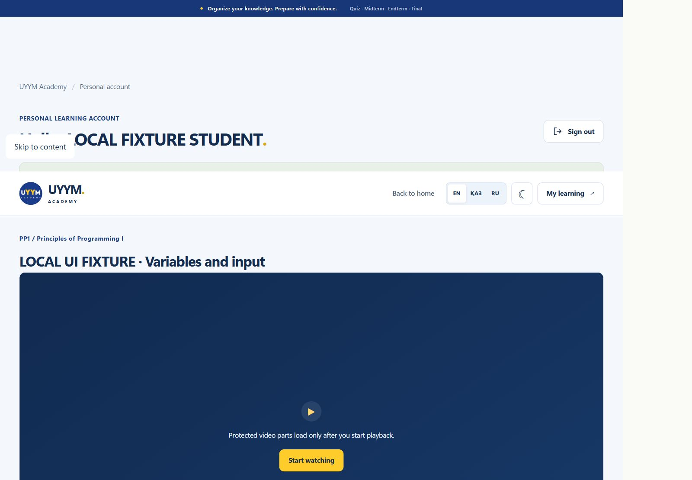 | 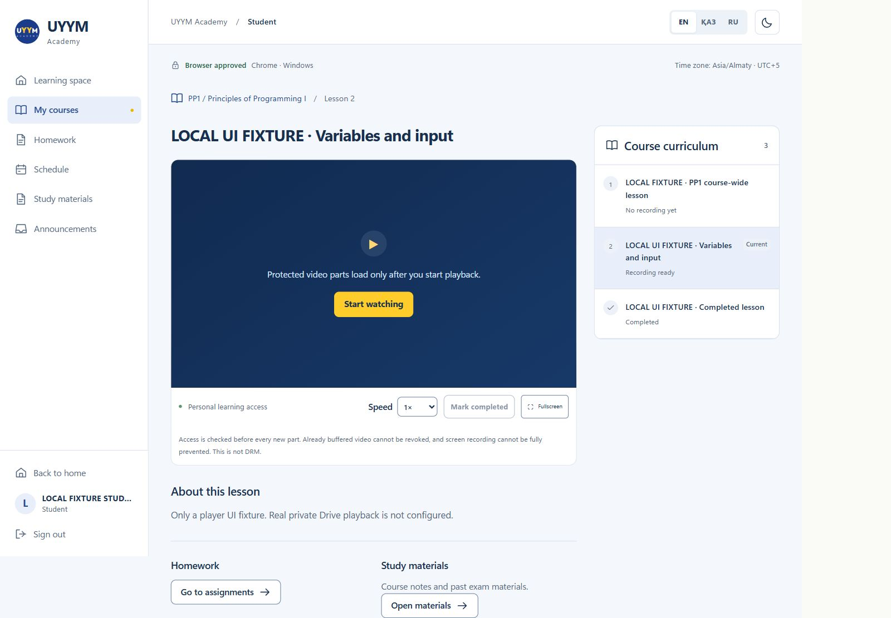 |
| TEACHER | 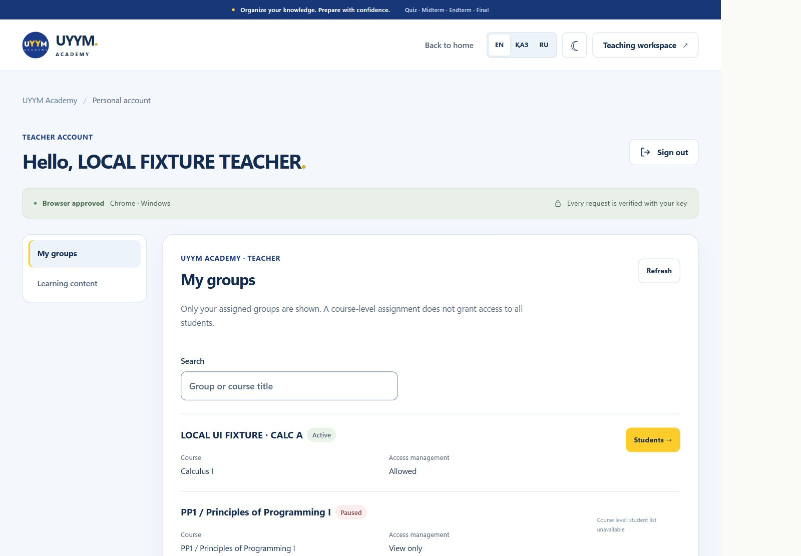 | 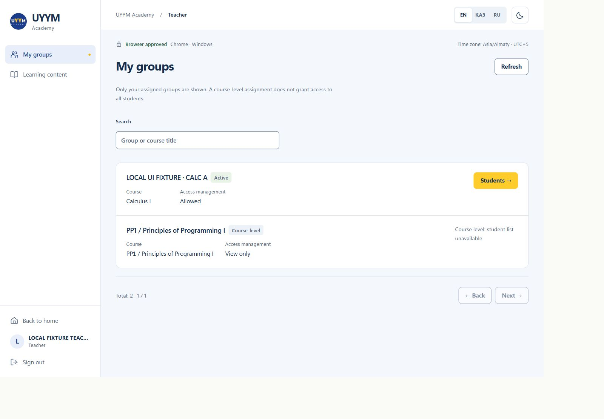 |

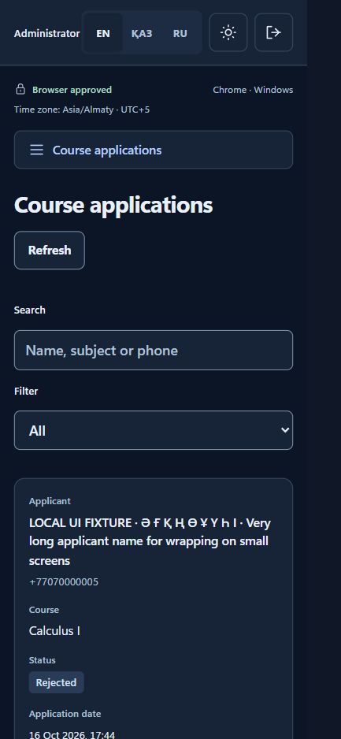
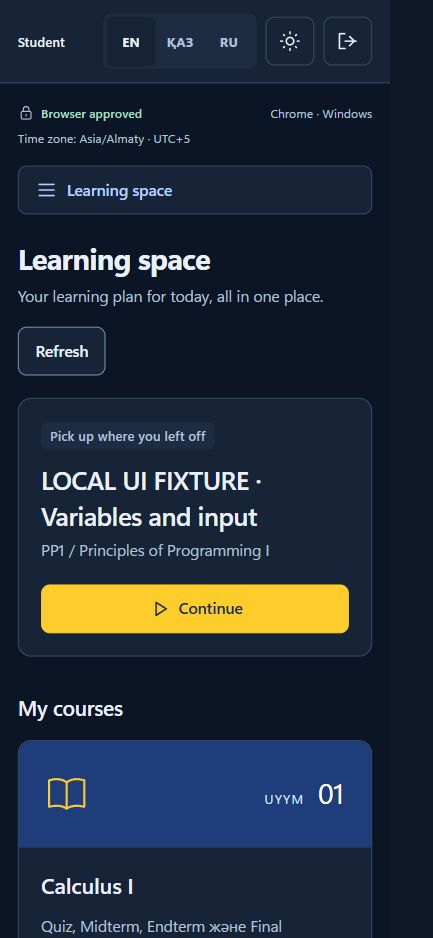
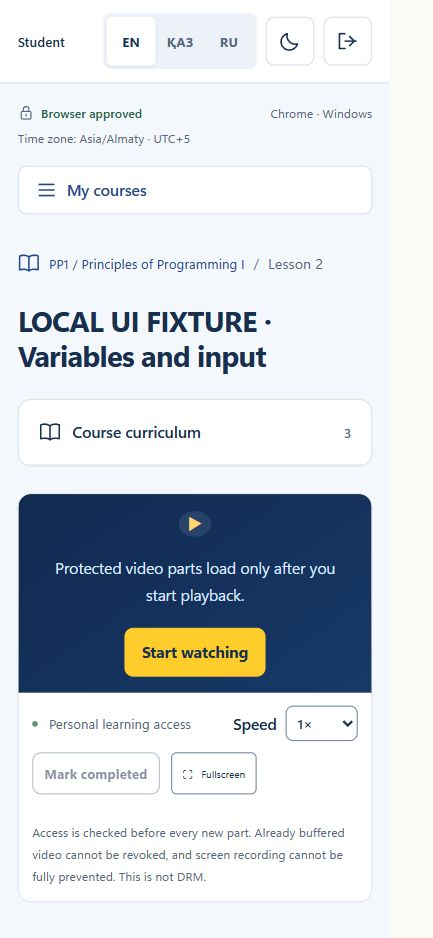
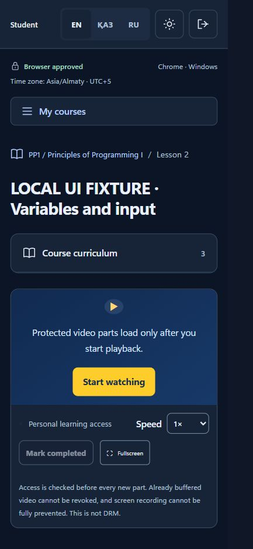

До публикации: ревью локального коммита, проверка настоящих материалов в разрешённой сессии и отдельное согласование выпуска. Этот redesign не отправлен в GitHub и не опубликован на `uyym.app`.
